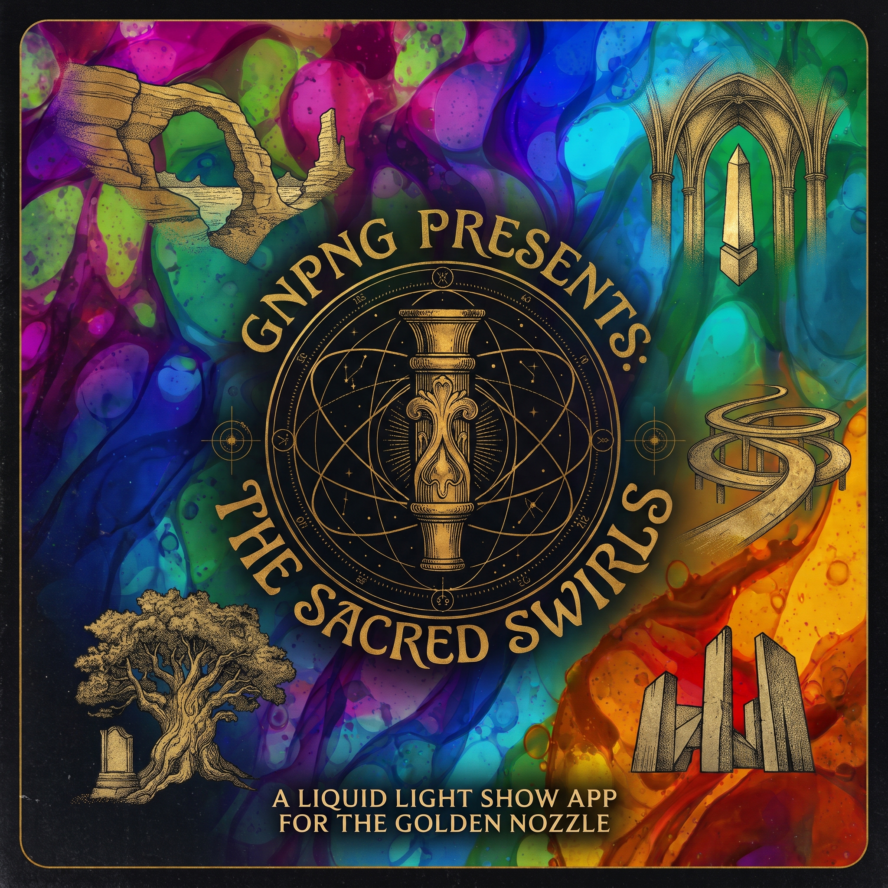

# The Sacred Swirls



The Sacred Swirls (TSS), EPNI-018, is a desktop liquid-light instrument. Two independently simulated films sit between parallel glass plates. Each has its own dye, carrier, in-plane motion and optical depth. The Windows editor projects light through both films with a shared adjustable focus.

## Current development build

[Windows download](https://github.com/GNPNG/tss/releases/tag/v0.1.0-preview.2) · [Start performing](docs/windows-preview.md)

In the source build, choose **Violet / Blue → Slide motion → Wheel with coral beads**. Small cyan drops pinch off the front slide while the original violet oil wheel moves behind the glass. **Replay front beads** starts the release again at the current rear-wheel position. [Full projection](experiments/slide-look-study/approval/coral-wheel/coral-wheel.mp4) · [Half-speed close-up](experiments/slide-look-study/approval/coral-wheel/coral-wheel-detail-half-speed.mp4)

**Projected films** lets you inspect either film in isolation and return to the moving overlap. [Watch the rear film, front film and combined projection side by side](experiments/slide-look-study/approval/coral-solo/coral-solo.mp4)

The coral wheel sustained 40.00 FPS on the Windows GTX 1650 Ti Max-Q at both 640 × 360 and 960 × 540. Each 12-second trial recorded 481 successful presentations, three front-slide replays, 475 applied mouse movements and zero skipped acquisitions. [Windows presentation timings and GPU telemetry](experiments/slide-look-study/approval/coral-wheel/windows/README.md)

The source build adds **Slide motion → Coral release**. Watch the front film shed two drops, then pull focus through them onto the violet film behind. [Radeon capture](experiments/slide-look-study/approval/coral-release/coral-release.mp4) · [Full-size frame](experiments/slide-look-study/approval/coral-release/coral-release.png) · [How the films were solved and measured](experiments/coral-release/README.md)

- Open MP3 or M4A audio and preview a waveform with synchronized liquid-light motion.
- Add, select, hide, reorder and remove liquid layers. Adjust each layer's palette, hue, flow speed, scale and opacity.
- Export an 8-bit development preview of the current liquid composition and audio as 3840×2160 H.264/AAC MP4 at 30 fps. Rendering runs frame by frame and can be cancelled.
- On Windows, export the selected Mathmos wheel and scheduled slide gestures in 4K on the same GPU used for live preview. [Starting poses and native MP4 output](live-wheel/README.md#export-the-selected-wheel)

Windows opens on the Violet / Blue wheel. Choose a wheel and select **Rear slide** or **Front slide**. **Material tug** draws the liquid toward a drag, **Rotate slide** turns the glass and **Press slide** squeezes the selected film at the contact point. The glass extends beyond the visible gate. Move **Projector focus** to bring either film into focus. [Live controls](live-wheel/README.md) · [Seven wheel studies](experiments/slide-look-study/approval/wheels/README.md) · [Focus pull](experiments/slide-look-study/approval/focus/violet-blue-rack-focus.mp4) · [Press and release, rear then front](experiments/slide-look-study/approval/pressure/slide-compression.mp4)

Open a song, expand **Gesture macros** and select **Record gesture**. You can replay a take at its original song position or attach it to a recurring musical or lyric phrase. Each macro has an enable switch, per-occurrence mutes, amount, gain per recurrence and a ceiling. [Recording and trigger controls](experiments/phrase-triggers/README.md)

The native wheel supports recursive video feedback and a separate audience window with adjustable A/V delay. The selected-wheel exporter renders 3840 × 2160 H.264/AAC from the native optics, song and scheduled gestures. [Projector and cue audio](experiments/projector-output/README.md) · [Feedback comparison](experiments/slide-look-study/approval/feedback/feedback-comparison.mp4)

The GTX 1650 Ti Max-Q delivered 39.95–40.00 FPS across all seven wheels at 640 × 360 with finite-pixel optical sampling. Both Violet / Blue gesture tests ran at 40.00 FPS. All 3,843 measured presentations succeeded. The frozen-frame capture/replay test reproduced both 38-event gestures byte for byte. [Windows measurements and recordings](experiments/slide-look-study/approval/windows-live/gesture-controls/README.md)

The released pressure build presented 481 Violet / Blue frames at 640 × 360 with zero skips on the same Windows GPU. During the 12-second rear-slide trial the editor applied 283 mouse movements and sustained 40.00 FPS. Median frame spacing was 25.01 ms and the 99th percentile was 25.63 ms. [Windows capture and timings](experiments/pressure-study/windows/README.md) · [Frozen-slide footage and phase volumes](experiments/slide-look-study/approval/pressure/README.md)

## Experiments

The [library and demo catalog](docs/library-catalog.md) records the implementation language, GPU API, model, potential TSS use, port decision and test evidence for each candidate. [Sortable CSV](docs/library-catalog.csv) · [Second-pass material comparisons](https://gitea.gnomatix.com/gnpng/org/issues/13)

These independent studies cover the input, controller and production pipelines.

- [Gesture input](experiments/gesture-input/README.md) exercises the WebKit force and Pointer Events adapter shared with the controller surface. Physical Magic Trackpad, built-in trackpad and Pencil sensor trials remain open.
- [Performance surfaces](docs/performance-surfaces.md) describes the optional compiled Go listener, HTTPS pairing and mapping per connected surface. The Windows host receives separately identified input streams. The earlier [wireless study](experiments/wireless-control/README.md) records the transport experiment.
- [Liquid fluid](experiments/liquid-fluid/README.md) studies separate evolving color fields and gesture forces. Its appearance is not yet an acceptable match to the references.
- [Rec.709 plate conversion](experiments/rec709-plate/README.md) tests conversion of genuine floating-point samples to 16-bit samples. It does not yet produce application exports.

The pressure and rotation cues use the same order in the live scheduler and the 4K export, including when several gestures fall between preview frames. The multi-surface transport has been exercised with synthetic Pencil and trackpad events. Identifying two physical trackpads presented as one pointer by the same WebKit host remains an open hardware question. [Input and replay specification](docs/slide-computation-spec.md) · [Liquid-light research](docs/liquid-light-research.md)

## Run from source

Install Rust 1.88, Go 1.23 or newer for the optional controller executable, and the platform prerequisites for Tauri 2. MP4 export uses FFmpeg with the `libx264` and AAC encoders on `PATH`. The pinned Rust toolchain is declared in `rust-toolchain.toml`.

```sh
mise run dev
```

To run the editor without building the optional controller executable, use `cargo run --manifest-path src-tauri/Cargo.toml`. The first build downloads Rust dependencies. A release build with both executables is available with `mise run build`. On Windows, package them together using `scripts/package-windows.ps1 -Tag <tag> -OutputDirectory <directory>`.

On a macOS system where a third-party Clang installation is unavailable, select Apple's compiler for a build.

```sh
CC=/usr/bin/clang CXX=/usr/bin/clang++ mise run dev
```

Audio files are read locally. Export writes a new MP4 and refuses to overwrite an existing file. Rendering and encoding speed depends on the device and composition.

## Verification

`mise run test` runs the Rust tests. The repository also tracks ongoing work in the GNPNG TSS epic and its linked issues.
