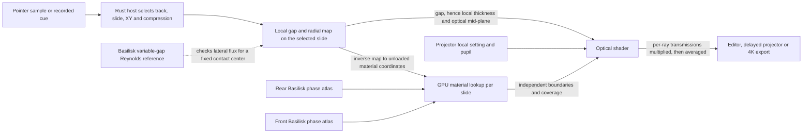
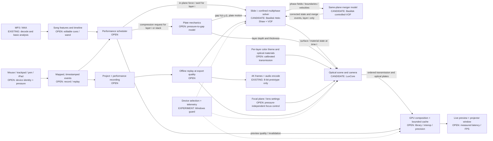

# Confined-slide computation specification

Two independent Basilisk slide solves supply the native Windows preview and the seven wheel themes. The pressure control deforms either solved field using a prescribed, volume-conserving plate gap. The owner approved the Violet / Blue rack focus. The earlier 640 × 360 Windows wheel benchmark measured 39.92–40.00 FPS. Calibrating physical sensor force to glass deflection and measuring same-slide coalescence remain open. [Pressure reference](../experiments/pressure-study/README.md) · [Windows wheel benchmark](../experiments/slide-look-study/approval/windows-live/README.md) · [Focus proof](../experiments/slide-look-study/approval/focus/README.md)

## Native pressure path

The live shader receives one pressure uniform per slide. It samples each original field in its own coordinates, including the slide's rotation and material tug. For optics, the selected gap scales absorption along the dyed path and changes the liquid mid-plane's distance from focus. The photographed wheel fit supplies the carrier tint. The independent CPU reference runs during model verification. The GPU evaluates the radial map directly during performance. [Native map](../live-wheel/src/pressure.rs) · [Field lookup](../live-wheel/src/fields.wgsl) · [Lens and transmission](../experiments/slide-look-study/optics.hook)

## Choosing methods for each material

A preset can combine different libraries for interface evolution, performer response and projected appearance. Dependency count is secondary to visible results and measured cost on the target hardware. Load or execute a method only for the stages and presets that use it. The common inputs and outputs are slide identity, time, geometry, optical depth and recorded controls. These allow one stage to consume another library’s result without requiring both to use the same internal representation.

| Material | Behavior that matters in motion | Candidate live treatment to compare |
|---|---|---|
| Oil and water | Same-gap necking, merger, capillary relaxation and viscous drag | Cache independently solved interfaces. Compare low-resolution dynamic updates and a fast per-slide warp under the same gesture. Tune optical rim width and dye overlap against the photographed wheels. |
| Wax | Motion changes with melt fraction. The solid and molten regions transmit light differently. | Compare a thermal prepass plus phase-dependent shading against an artist-tuned melt transition. |
| Slime | A stretched filament retains strain and recoils after release. | Compare a viscoelastic solve with a reduced model that retains deformation history. |
| Glass and hard sugar candy | A rigid boundary refracts and transmits light. Candy can carry tint and inclusions. | Reuse the geometry while recalculating refraction, attenuation and focus. A flowing or heated sugar preset would require separate material data. |
| Hydrophobic sand | Grain aggregates hold and break; trapped air changes how immersed grains reflect light. | Compare resolved boundaries with a cheaper aggregate surface and calibrated highlights. |

These options are candidates. Today the seven wheel choices select optical fits on a common pair of oil trajectories. The native solver can independently generate alternate oil trajectories from measured properties. For each proposed treatment, hold the material, starting fields, gesture, palette and focus fixed; compare the motion and edge behavior side by side. Record frame-time percentiles, input latency where measured, and the operator's visual preference. Label art-directed controls separately from parameters with physical units. Cross-slide mixing stays forbidden. Record performance inputs for replay; the offline pass can spend more on the same performance. [Material data](../live-wheel/MATERIAL-MODELS.md) · [Specialty materials](../live-wheel/materials/specialty.json) · [Library evaluations](dependency-register.md)

The production application must start and operate without launching Node or Python. Use the Tauri Rust host for the editor, native GPU submission and frame scheduling. Go is a preferred candidate for independently built peer or batch components; use a C ABI for C/C++ library integration and verify the target compiler and linker on each supported platform. Keep CPU/GPU transfer boundaries explicit. A worker process or language transition inside a per-pixel or per-frame loop requires a measured reason. Browser JavaScript already running in a Tauri webview does not require a Node runtime. The approved Blender scene script is a research fixture with Blender's bundled API. It creates no production dependency.

Presets should describe the material pair, independently versioned motion, geometry and optical methods, physical values with units, creative adjustments, and per-slide live sampling/filter choices. For a recorded performance, preserve the source fields or their reproducible inputs, method identifiers and revisions, calibration, random seeds where used, and the event timeline. The material review tracks these as composable design requirements. [Master catalog](library-catalog.md) · [Second-pass review](https://gitea.gnomatix.com/gnpng/org/issues/13)

## Computation graph

The diagram is a proposed dataflow. `EXISTING` identifies a limited piece already exercised; `CANDIDATE` identifies real library capability whose required integration is unproved; `OPEN` identifies work for which no qualifying implementation has been established. Arrows do not mean that integration already works.

`S` and `C` are instantiated **separately for every slide layer**. No physical phase field, merger operation or topology ID is shared across layers. The stack may receive a common performance gesture, but that is mapped into individual layer inputs; projected overlap cannot combine bubble topology across planes. Distinguish a bubble from a physical material: multiple colored regions may be dyes within a phase or separate phases. The images alone do not establish which.

The current [WebGL renderer](../WebAssets/liquid-renderer.js) and [prototype composition/export](../WebAssets/app.js) remain existing behavior; neither implements this graph. Do not remove or replace them as an incidental part of this study. The [LuxCore GPU stock-scene test](../experiments/luxcore-native-study/output/windows-gpu-full-scene-photographic-20261119/EVIDENCE.md) exercises `PATHOCL` on the Windows NVIDIA GPU; it is not a slide render. Basilisk's stock [Hele–Shaw example](https://basilisk.fr/src/examples/hele-shaw.c) uses an advected composition/viscosity field; it does not establish immiscible interfaces, merger timing, wetting or changing gap. The later fixed-field proof demonstrates the TSS focus pull. [Rendered clip](../experiments/slide-look-study/approval/focus/README.md)

## Node responsibilities and data contracts

Coordinates are right-handed physical slide coordinates: `x,y` lie in each slide's plane; `z` increases from light source toward the output surface. All geometric lengths and gaps use metres; timestamps use integer audio sample positions plus sample rate, or a monotonic nanosecond timestamp before alignment to the song. Rates and material quantities retain explicit SI units. Image pixels use top-left origin, with the mapping to slide coordinates and crop recorded. Color values used for light transmission/compositing are linear-light values with declared primaries and transfer function; the final output transform is explicit. These are proposed TSS contracts, not claims about current file formats.

| Node | Input → output | Software / evidence and boundary |
| --- | --- | --- |
| Input and timeline | Device ID, input kind, normalized force/pressure when supported, contact position, event time, target slide(s); audio features/cues → ordered per-slide commands | Existing app has audio decoding and basic features; device-specific identity, simultaneous devices, Apple Pencil, pressure capture, mapping and deterministic timeline recording are open. A reported normalized pressure is a control signal, not pressure in pascals. Store source device, calibration, time base, target, units and saturation information. |
| Plate mechanics | Calibrated compression command, existing plate positions, material geometry → per-slide gap `hᵢ(x,y,t)`, plate position and velocity | Open. Map the trackpad pressure signal to a calibrated force, displacement or prescribed gap according to the selected mode. Do not pass a normalized pressure value directly to a fluid pressure solver. Moving boundaries, conservation and any spatially varying gap require support and validation in the selected solver. |
| In-plane dynamics | Per-slide phase fractions or level sets, bulk velocity, viscosity, density, interface tension, wetting/contact angle, gap, forces, boundary conditions, prior state, time step → resulting per-slide state, interface geometry and solver diagnostics | [Basilisk Hele–Shaw](https://basilisk.fr/src/hele-shaw.h) is a candidate depth-averaged pressure/advection solver; [Basilisk VOF](https://basilisk.fr/src/vof.h) and [surface tension](https://basilisk.fr/src/tension.h) are separate capabilities. Their joint use for variable-gap, multiphase wetting in this scene has not been demonstrated. Choose a tested established solver, not a new project-written numerical solver. A whole interior particle population is not required by this contract. |
| Merger | Same-slide interfaces, distance/contact history, material/film parameters and calibrated merger criterion → no merge or a same-slide coalescence event and resulting interface state | Ordinary VOF interfaces may merge when separated by roughly a grid cell, which is not proof of correct physical timing. [Basilisk's selective tracers](https://basilisk.fr/src/no-coalescence.h) can prevent automatic merging; the separate [controlled-coalescence sandbox](https://basilisk.fr/sandbox/mani/control_no-coalescence.h) uses a prescribed contact time. Its physical calibration, licensing, integration and GPU execution are open. No merger may receive IDs from two different slides. |
| Optical projection | Ordered slide surfaces/fields, per-material optical properties, glass, thickness, light source, camera/lens and focal plane → linear radiance/plates and optional depth, material-ID and transmission data | [LuxCore 2.11.2 C++ API](https://github.com/LuxCoreRender/LuxCore/blob/samples-v2.11.2/include/luxcore/luxcore.h) accepts meshes; its [volume example](https://github.com/LuxCoreRender/LuxCore/blob/samples-v2.11.2/scenes/media/vol-pri-test-glass.scn) illustrates separate media. Actual field-to-scene conversion, proper layer ordering, cross-plane refraction and focus for a slide stack remain untested. Preserve transparent layers' contribution to transmitted light and caustics even if their directly visible detail is defocused. |
| Real-time composition | Rendered plates/short sequences, available depth/transmittance, input transform events and selected quality → live projector/preview frame | [PixiJS filters](https://pixijs.com/8.x/guides/components/filters) and [Skia image filters](https://api.skia.org/classSkImageFilters.html) are unselected candidates for blur, blending and displacement. Their API existence does not establish a physically correct swirl, interop with LuxCore, 16-bit color or target-GPU performance. Cached image effects are approximations; replay the same image operation for export, and separately replay physical inputs where a control is mapped to the solver. |
| Export | Exact project snapshot, input event stream, solver version/configuration, seeds, cache identities, audio and requested FPS/resolution → timestamped frames and encoded output | The prototype's FFmpeg path encodes an 8-bit H.264 preview; [the actual code](../WebAssets/app.js) is not this design. Full 3840×2160 output, Rec.709/Display P3, 16-bit layered plates and synchronization require implementation and verification against the [production specification](golden-nozzle-media-pipeline.md). Do not claim cross-device bitwise determinism; measure replay fidelity. |

### Pressure versus pressure

The performer controls a trackpad or pen **pressure input**, a normalized device reading whose calibration and valid range depend on the device. The plate node converts that input into a specified physical actuation, such as displacement in metres or force in newtons. The resulting gap and boundary motion enter the fluid model. The solver's **pressure field**, in pascals when dimensional, is an internal state determined by its equations and boundary conditions. A pressure-Poisson iteration count or a shader parameter called `pressure` is not the performer's plate compression. This distinction is required in code, UI, recording and tests.

Where the selected depth-averaged model represents an incompressible closed slide, its gap and flux must satisfy the model's mass/volume conservation under compression. Surface tension, wetting and any film-drainage/rupture rule must be provided by the established solver or a separately verified established component. For live use, solve in the plane at a resolution justified by convergence and interface appearance; a 4K frame is not a requirement to run the fluid solver on a 4K grid.

### Boundary and fill separation

The owner proposes using the outer boundaries of bubbles as bounds and filling their interiors for graphics. The solver supplies evolving per-slide interfaces and the bulk fields needed for their motion and within-slide mergers; an established graphics component fills the enclosed regions with material/color data at the output resolution. Optical edge treatment, transmission and depth-dependent focus are rendering operations driven by that state. Interior render pixels do not each require a simulated particle. Boundary topology, shared-plane merger behavior and preservation of independent slide domains must survive any contour or mask conversion. The fixed-gap implementation reconstructs the VOF interface and packs each slide in a separate signed-distance channel. [Solver and output data](../experiments/slide-look-study/solver.md)

### Focus and the through-stack axis

The focal plane and each slide depth are explicit physical scene parameters. Use the selected optical renderer's lens/camera model or a validated equivalent to determine layer-dependent out-of-focus response. A simple per-layer blur is a possible preview approximation, not automatically equivalent to the actual projector optics: test it against an optical reference with overlapping transmissive material, changing gaps and bubble rims. Compression can alter depth and thickness independently of the selected focal plane; record both. The user explicitly requests live pressure-driven compression and pen-driven swirl.

## Scheduling, cache and device contract

1. **Prescan:** decode the song and derive time-indexed features. Compile the selected timeline, saved tracks and magic-wand templates into per-layer commands. Track exact song/sample time; do not consume a cached result made from a different project, audio hash, input history, seed, solver version, layer order or material configuration.
2. **Prepare and buffer:** precompute only data whose inputs are known. A bounded queue holds upcoming states/plates, cropped to useful regions where valid. On new live input, invalidate the affected future states and dependent optical/composite frames, then schedule replacement work; keep input-to-display latency measurable. Do not discard a hidden/transmissive layer's contribution to other light paths.
3. **Live:** update each independent slide with its own state and commands; compute/cache optical plates, apply documented live image operations, compose in depth order, and present in the preview/projector. Quality controls may vary simulation resolution, optical sampling or plate detail according to focus, visibility and a measured per-device budget. Preserve simulation continuity. Record the exact quality setting used and the control events, not just the displayed result.
4. **Record/export:** replay the saved timestamped events with the same target layers, mappings and seed; apply actual image-space controls at export resolution, and replay physical controls in the solver when supported. Produce both a rendered frame sequence and muxed audio video. Compare export to the recorded live performance and separately assess optical quality.

One 3840×2160 RGBA 16-bit-per-channel plate requires `3840 × 2160 × 8 = 66,355,200` bytes (~63.3 MiB) before depth, extra buffers, mipmaps, staging or allocator overhead. Queue depth, region bounds, output precision and available GPU memory must therefore be explicit; both target discrete GPUs have 4 GB. That calculation is a capacity estimate, not a measured transfer rate or throughput.

`wgpu` has been exercised experimentally on macOS Metal and Windows Vulkan/DX12, but no coupled solver or LuxCore interop is established. The live renderer, fluid solver and compositor must enumerate actual devices and supported backends rather than require a model name. CPU + GPU may be used concurrently with scheduling appropriate to the measured machine. Do not interpret WSL GPU visibility as proof that Windows Job Objects contain WSL processes; shared reservation, process lifetime and telemetry across that boundary remain to be tested. Sampled utilization cannot guarantee GPU/driver recovery. Windows is the current test host; native Windows and Intel Mac Radeon support remain required independently of a WSL development build.

## Implementable verification sequence

1. **One real slide, fixed gap:** run an existing confined-flow example and retain its actual field and frames. Identify whether fields represent one concentration or genuinely distinct immiscible phases. No generated bubbles or optical realism are claimed from the stock concentration example. Then validate a same-plane two-phase interface, surface tension and merger fixture against the selected solver's documented tests and a suitable independent reference.
2. **Field to optical render:** feed actual solver state into an established surface/texture representation and LuxCore scene; configure glass, media, light and camera. Produce an actual still and short motion sequence. Show raw solver field next to the rendered output so a reviewer can see what produced every bubble and boundary. Identify interpolation, data conversions and material settings; do not substitute static hand-drawn shapes for simulation output.
3. **Layer separation and optics:** run at least two independently initialized slide states; force a merger in one while both are optically superimposed. Verify the other layer's fields/topology are unchanged, changing depth/focus affects sharpness in the intended direction, and transmission/order behave as specified. Repeat with transparent, bright and near-opaque overlaps.
4. **Compression and input:** apply a recorded calibrated pressure trajectory, verify gap and solver state respond, and test conservation and within-plane coalescence. Compare fixed-gap and changing-gap cases. Verify motion from simultaneous devices is mapped to the correct slide and replayed at the right song time.
5. **Performance and appearance:** capture actual GPU/CPU timings, memory and input latency at selected preview settings and 4K export. Compare reduced focus/visibility budgets to a full-quality reference. Show actual stills and video for the owner's approval against the supplied blue/violet, red/blue, red/gold, green/cyan, green/yellow, pastel and red/magenta slides and the six approved color-theme panels. Record settings, device, library revisions, scene and input-event provenance.

The fixed-state focus proof measures edge sharpness for each slide at both focal endpoints. The wheel gallery contains actual offline 4K outputs. Controlled merger, compression, live presentation and performance-replay trials remain open. [Focus measurements](../experiments/slide-look-study/approval/focus/README.md) · [4K gallery](../experiments/slide-look-study/approval/wheels/README.md)

## Implementation Gantt

The columns are ordered implementation checkpoints, not estimates of calendar time. Work marked `█` is required in that checkpoint; `●` is the current bounded optics study. No delivery dates or durations have been measured.

| Workstream | 1. Single slide | 2. Animated physics | 3. Layered live | 4. 4K and platforms |
| --- | :---: | :---: | :---: | :---: |
| LuxCore glass / color / focus optical test | ● |  |  |  |
| Confined per-slide interface solver and within-layer merging | █ | █ |  |  |
| Actual solver state → renderable slide | █ | █ |  |  |
| Independent slide stack and optical composition |  | █ | █ |  |
| Compression, pen/pressure mapping and event recording |  | █ | █ |  |
| GPU live scheduling, resolution and cache |  |  | █ | █ |
| Replay, 4K export and audio synchronization |  |  | █ | █ |
| Windows / macOS validation and visual approval | █ | █ | █ | █ |

The dependency order is: a real single-slide solver state and an optical test → their integration → isolated multiple slides and live controls → recorded 4K output and cross-platform verification. Static geometry is an optical test only and does not satisfy the simulation requirement.

## Conserved slide state, projector gate and live delay

Each slide has its own sealed domain Ω, a persistent in-plane pose, and separate material volumes. Let h be the local glass gap and φₖ the through-gap volume fraction of phase k. The constraint for each constituent is Vₖ = ∫Ω hφₖ dA, constant through every recorded gesture. For a completely filled cell, ∑φₖ = 1. At fixed gap the in-plane kinematic map for incompressible material has determinant +1. Under local compression the dimensionless area-freezing criterion becomes h′(F(X)) det DF(X) = h(X) for a column transported without through-gap exchange. A filled cell with a fixed sealed perimeter requires physical accommodation for the volume displaced by a squeeze. When the visible crop loses dye, the offscreen slide still owns it.

Material tug deforms the occupied region in X and Y with a bounded response. Slide rotation applies one rigid in-plane transform to the entire selected glass and its contents. These are independent controls. The lens focal plane and plate compression are the two user controls involving Z. Within the geometric-optics model, a screen pixel receives the pupil-weighted *linear transmitted light*. For each ray, multiply the independently sampled sheet transmissions and integrate the result over the pupil and pixel. For example, half coverage by a film transmitting 20% in one channel yields 60% transmission in that channel. Full-field uniform transmission remains constant when the focal plane moves. A narrow isolated filament broadens as it defocuses and continues to absorb the rays that cross it. The attenuation integral of an isolated absorption-only feature remains constant under a normalized blur when the measurement includes the entire blur footprint. Refraction and light falling outside the measurement window require separate accounting. [Optics implementation](../experiments/slide-look-study/optics.hook) · [Bright-field contrast transfer](https://pubmed.ncbi.nlm.nih.gov/15139436/)

The projector gate is a crop in slide coordinates. Its inverse-transformed corners specify which regions are needed from each plate. Include the largest pupil footprint, filter support, displacement and motion that can occur until the next prepared region is available. For arbitrary rotation about the gate center a square world at least as wide as the gate diagonal covers all orientations, before adding this margin. Build or retain the independent material fields over the entire chosen slide domain. Cache the next useful region and its optical inputs on each slide. A focus change can reuse geometry. A material gesture invalidates affected optical tiles and their dependent feedback frames. Crop the composited image for projection after evaluating the optical footprint.

### Cue, projector and video feedback

The DJ monitors the audio cue directly and sees a low-latency preview. Record each input against the audio sample position that the DJ hears, including compensation for measured cue-device latency. The audience audio route and projector video use one transport clock and matched effective presentation delay D. Compensate the projector and audience audio device latencies separately to meet that common deadline. For input song time s, the program frame for s is due at s+D. Future audio features and cached offscreen material are available for preparation. Future manual gestures arrive when the DJ performs them.

A feedback layer taps a prior completed image at song time s−d, with 0 < d < D for the proposed short feedback path. Transform it, apply loop gain, and combine it with the current visual layers. Use presentation timestamps to select the frame for s−d under variable render cadence. Read prior *program* frames including the prior feedback result for recursive feedback. Sampling an isolated slide instead produces an ordinary delayed-layer effect. Cache the linear program image before display encoding and operator controls. The recursive dependency limits how far ahead consecutive feedback frames can be evaluated. Multiple reads can share the history while the projector and the feedback layer advance independently.

At 48 kHz and 30 FPS, a 500 ms audience delay equals 24,000 audio sample frames or 15 picture frames. A 100 ms feedback tap reads three picture frames back. These are study settings, adjustable per performance. Size retained images for the longest required delay plus processing jitter and in-flight frames. Fifteen 640 × 360 RGBA16F surfaces occupy 26.4 MiB before alignment, compared with 949.2 MiB at 3840 × 2160. Keep stereo PCM for the same audience deadline. On a seek or a discontinuous transport change, start a history tagged to that transport position and prime the audience outputs together. A deadline miss should be logged against song time and exposed in the live deck. The native wheel now has a recursive GPU loop and a separate bounded projector video delay. The Windows editor exposes cue and audience audio routing. Physical output latency requires measurement on the selected display and audio endpoints. [Native output, comparison clip and numerical checks](../experiments/slide-look-study/approval/feedback/README.md)
