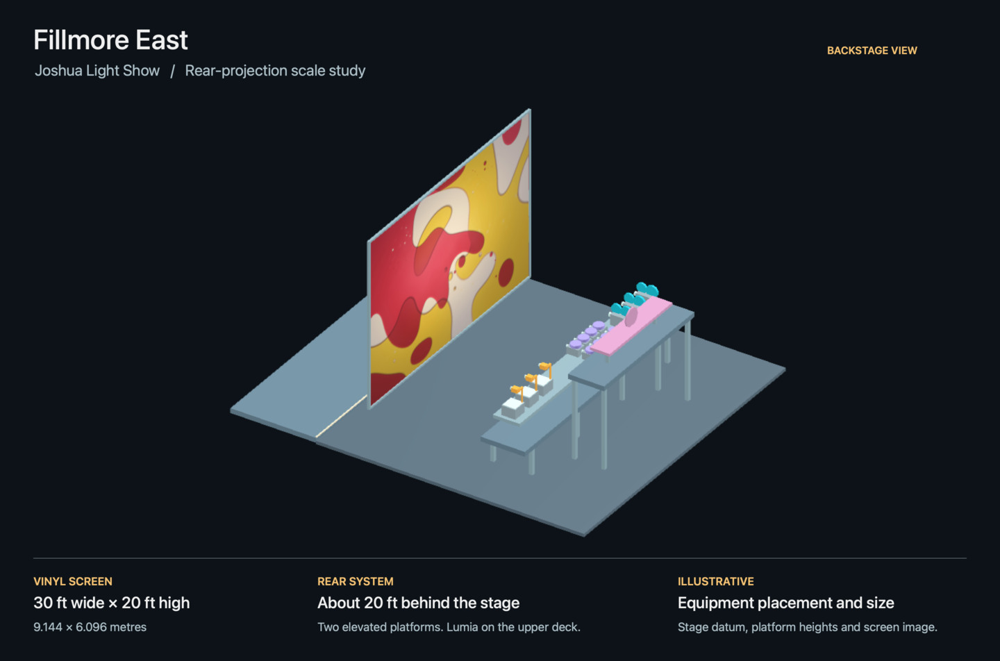

# Fillmore East rear-projection scale study



[Open the OpenUSD scene](fillmore-east.usda) with its [screen texture](screen-study.jpg) alongside it. The study uses metres, Y up and +Z toward the audience. Orbiting the model exposes each bank of projectors. The lower deck shows three film projectors in cyan, two banks of four carousel slide projectors in violet and three overheads in amber. A representative mirror wheel marks the upper lumia station.

| Archival evidence | Representation in the scene |
|---|---|
| One 20 × 30 ft vinyl screen | The screen mesh measures 9.144 m across by 6.096 m high. Landscape orientation, 0.90 m clearance and the trim are exhibit choices. |
| Rear-projection system approximately 20 ft behind the Fillmore stage | A thin floor line marks the illustrative Z = 0 stage datum. The center of the lower equipment deck sits at Z = −6.096 m. The historical account describes the location of the system as a whole. Individual projector throws and the distance between the equipment and the screen remain unknown. |
| Two elevated platforms. Tom Shoesmith worked the upper position with reflected and refracted light | Deck outlines, posts, heights and exact spacing illustrate the arrangement. The working positions on the lower deck are illustrative. |
| Inventory of three film projectors, two banks of four carousel projectors and three overheads | The model preserves those counts. All equipment envelopes, colors, alignments and lens shapes are schematic. The archive also lists eight 1,200 W landing-strip lamps. Their positions and photometry remain outside the model. |

Greg Zinman’s account on the Joshua Light Show site documents this equipment and staging. Theatre wall dimensions, seat layout, exact equipment specifications and historical screen luminance remain open research questions. [Artist archive and account](https://www.joshualightshow.com/about-classic/joshua-light-show-1967-68) · [Historical sources in TSS](../../docs/history/joshua-light-show.md)

The vinyl carries an image from TSS’s existing [yellow/red simulated slide study](../slide-look-study/approval/wheels/yellow-red-rec709.png). The study resamples the 3840 × 2160 frame to 1000 px wide, takes its central 840 × 560 px and saves an sRGB JPEG. The texture and lights illustrate the setup. They supply no evidence about a particular historic performance or its exposure.

## Reproduce the scale model and review frames

From this directory, create an output folder and package the existing USD scene and texture with Apple’s USD tools. Other OpenUSD readers can open the source directly. The macOS renderer requires native SceneKit and Metal.

```sh
mkdir -p ../../target/delivery/legends-review/venue
out=../../target/delivery/legends-review/venue
usdchecker fillmore-east.usda
usdzip --arkitAsset fillmore-east.usda "$out/fillmore-east.usdz"
usdchecker --arkit "$out/fillmore-east.usdz"
swiftc render.swift -o "$out/render-study"
"$out/render-study" "$out/fillmore-east.usdz" "$out/fillmore-east.png"
"$out/render-study" "$out/fillmore-east.usdz" "$out"
```

The first render produces the annotated orthographic still. The second produces left and right 1920 × 1080 perspective PNGs and `stereo.json`. The virtual eyes have a 64 mm baseline, parallel optical axes and an asymmetric horizontal projection to set zero disparity at the screen center. The eye images use a 42° vertical field of view. Pack each eye to 960 × 1080 and place left then right for a 1920 × 1080 half-side-by-side frame. The study camera sits at an invented backstage viewpoint.

The Radeon Pro 5300M rendered the archive after it passed Apple's ARKit compatibility checks. Six modeled landmarks had zero vertical disparity in the projection. The rendered eyes differed at 64,878 of 2,073,600 grayscale pixels. A quarter-pixel luminance patch comparison of 100 distinct corners measured median absolute vertical displacement of zero and 95th percentile 0.25 px. That raster measurement includes the effects of edge sampling. SceneKit loaded the USDZ and its embedded texture. A separate Quick Look thumbnail attempt on an earlier ASCII-root package timed out. Physical TV presentation is a separate check.

[OpenUSD stage units](https://openusd.org/release/api/group___usd_geom_linear_units__group.html)
