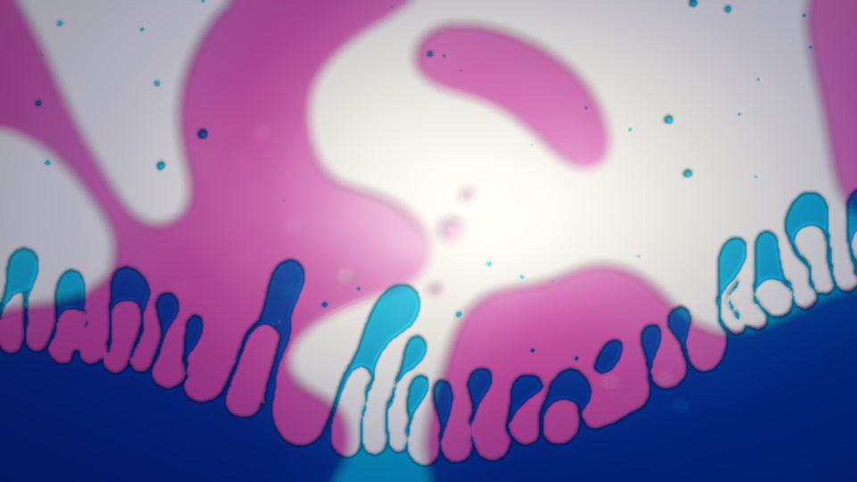

# Native 16-bit Rec.709 wheel plates



The Windows editor's **Export selected wheel · 4K 16-bit still plates** control samples the selected wheel's optical shader into an RGBA32F framebuffer. The renderer evaluates the illumination, both film geometries, common pupil rays, refraction and flare at 3840 × 2160. The source simulation caches store quantized signed-distance fields. Interpolation and material work use half-float textures. Optical color stays in floating point until PNG encoding. The tagged PNGs use full-range BT.709 RGB and straight alpha, with cICP bytes 1, 1, 0, 1. The preview above is a reduced sRGB rendering for web display. [Control and compositing instructions](../../live-wheel/README.md#export-still-plates) · [PNG cICP field definitions](https://www.w3.org/TR/png-3/#cICP-chunk)

The captured projection and two solo exposures each include their own lamp and clear carrier. The compositing set uses the lamp as its background. At each pixel the middle layer takes the background to the selected rear exposure. The foreground takes that result to the selected projection. For base RGB value B and target T in clipped linear light, the common alpha is the largest change required by any channel. A darkening channel requires (B−T)/B and a brightening channel requires (T−B)/(1−B). If every channel is unchanged the layer is transparent. Otherwise its straight RGB is B+(T−B)/alpha. This accounts for the ray interactions at the captured alignment. The alpha represents the required compositing change. The separate solo exposures show each physical film in isolation.

## Radeon verification

The guarded AMD Radeon Pro 5300M Metal run used Violet / Blue, **Wheel with coral beads**, front focus 0.9, rear time 2.635 s and front time 0.75 s. A 320 × 180 comparison against the native preview at identical sample positions and film times found a maximum difference of one sRGB code across all RGB channels. The native preview reproduced the same bytes after export.

FFprobe identified all six 4K images as full-range rgba64be with BT.709 primaries and transfer. FFmpeg decoded 65,269 distinct red codes, 63,126 green and 46,711 blue in the projection. MID used 61,690 distinct alpha codes and FG used 65,017. Across 24,883,200 RGB samples the linear-light BG/MID/FG reconstruction differed from the encoded projection by at most 0.00004275 on a 0–1 scale. RMS error was 0.00000781. [All channel counts and measured errors](radeon-4k-verification.json)

To independently check a finished bundle with Node, FFmpeg and FFprobe on PATH, run:

```sh
node experiments/rec709-plate/verify-plates.mjs "/path/to/TSS-violet-blue-…"
```

For a bounded Windows editor verification, pass `--verify-wheel-plates` followed by an existing absolute destination directory and optionally `--coral-beads-trial` to the normal editor under the existing hardware reservation procedure. This runs the same frontend controller and native export as the interactive button. The verification argument supplies the containing folder. The editor exits with the export result. Each successful export writes its own new bundle. The verifier checks all six PNGs including their metadata and computes per-channel precision and reconstruction error.

The Radeon test uses `coral_capture::capture_digital_4k_plates` from the live-wheel test binary with `--ignored --exact`, an explicitly selected `TSS_LIVE_ADAPTER` and an existing `TSS_PLATE_CAPTURE_DIR`. Its unoptimized run took 156 s including six PNG encodes. PNG metadata uses cICP. ICC profile embedding, Display P3, print conversion, and downstream compositor import tests remain open under issue #8.

## Sample conversion reference

The original raw reference and the application use the same finite-sample quantizer. It clips to the unit interval, applies the BT.709 OETF to RGB, leaves alpha linear and rounds once to 16 bits. The raw reference writes top-down, little-endian interleaved samples. PNG serialization uses big-endian samples. The original independent 4K fixture matched the raw reference byte for byte before and after an FFmpeg PNG round trip.

```sh
rustup run 1.88.0 rustc --test --edition 2021 experiments/rec709-plate/plate.rs -o /tmp/tss-rec709-plate-tests
/tmp/tss-rec709-plate-tests
```

The Windows editor at `2a2ace1` exported the same six UHD plate types through the normal Tauri control on the GTX 1650 Ti Max-Q. All 24,883,200 reconstructed linear RGB samples were compared after independent FFmpeg decoding. Maximum absolute error was 0.00004208 and RMS error was 0.00000781. [Windows channel counts and measurements](windows-4k-verification.json)
