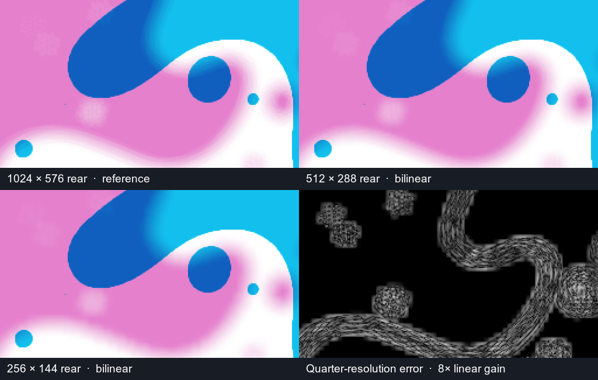

# Defocus-aware slide resolution

Frame 048 fixes the focus on the front slide. Keeping that slide at 1024 × 576 and evaluating the rear at 512 × 288 gives a full-frame linear-RGB RMSE of 0.00236 with bilinear reconstruction. At slide-edge crossings, 95% of pixels have a largest-channel absolute error at or below 0.0180. At 256 × 144, the crossing value rises to 0.0284. These measurements cover one static frame and the optical terms described below.



The 256 × 144 crop starts at source pixel (264, 264), measured from the top left. It contains 1,233 crossing pixels, the largest count among 8-pixel-spaced candidate crops with a 16-pixel frame margin. Every panel uses the same crop and 2× nearest-neighbor enlargement. The lower-right panel shows eight times the largest absolute **linear** channel error for quarter-resolution bilinear, then applies the display transfer curve. Black is zero. The native-resolution full reference is available separately. [Full reference](reference.png)

## Measurements

All values use linear transmission on a 0–1 scale before display encoding. RMSE weights all three channels equally. The crossing and plain columns give the absolute error of the channel with the largest difference at each pixel. [Complete per-region CSV](error.csv)

| Rear sample grid | Reconstruction | Full-frame RGB RMSE | Crossing p95 | Crossing peak | Plain p95 |
| --- | --- | ---: | ---: | ---: | ---: |
| 512 × 288 | Bilinear | 0.002362 | 0.018002 | 0.035289 | 0.0000072 |
| 512 × 288 | Catmull–Rom | 0.002259 | 0.017241 | 0.037392 | 0.0000072 |
| 256 × 144 | Bilinear | 0.003924 | 0.028448 | 0.066511 | 0.0000072 |
| 256 × 144 | Catmull–Rom | 0.003822 | 0.027800 | 0.070216 | 0.0000204 |

The 3,178 crossing pixels lie within 3 design pixels of a front boundary and within one rear pupil radius plus 1 design pixel of a rear boundary. The 466,128 plain pixels lie outside both bands. The CSV also reports the rear edge away from the front boundary. An isolated front edge contributes to whole-frame statistics. Cubic reconstruction reduces whole-frame RMSE slightly in both cases and increases the worst crossing error in both.

## Optical model

The input is the signed distance to each slide's own boundary, stored in the lossless float EXRs exported from the fixed Basilisk frame. The experiment reads the actual violet-blue absorption coefficients and 24 antipodal pupil positions from the shared shader. An 8 mm pupil radius, 1,600 mm throw, and object distances of 51.8 mm and 53.4 mm give a signed rear footprint of −13.327 design pixels at front focus. This is −10.662 pixels at the reference raster and zero on the front. [Field provenance and units](../../lighting-geometry.md) · [Shared optical shader](../../optics.hook)

For each rear pupil sample, the experiment reconstructs the signed distance bilinearly, evaluates the shader's smooth boundary coverage, and computes transmission per channel as exp(−absorption × coverage) at unit optical depth. It averages **transmitted light** across the pupil. It computes each candidate rear buffer directly at the registered pixel centers of its own grid, then reconstructs its three float channels to 1024 × 576 using libswscale. The same sharp front transmission is multiplied into every candidate at full resolution. A two-axis ramp and a constant field check resampler registration at both ratios.

The comparison isolates absorption, boundary coverage and finite-aperture defocus. It holds illumination uniform and optical depth constant, and omits directional rim light, refraction from the front into the rear slide and paired-density correction. The fixed front focus lets its transmission factor out of this simplified pupil integral. A focus pull changes that condition. This CPU experiment measures image error only. Windows presentation cadence, GPU pass cost, other wheels and motion through crossings require their own measurements.

## Reproduce

From this directory, build with the system C++ compiler and installed OpenEXR, libswscale and libavutil development packages. Pass a fresh output directory. The program writes the reference, four reconstructed composites, two amplified bilinear error maps, and the numeric CSV. The PPM and PGM files are display encoded. Metrics use the original float arrays. [Comparison source](compare.cpp)

```sh
c++ -std=c++17 -O2 compare.cpp $(pkg-config --cflags --libs OpenEXR libswscale libavutil) -o /tmp/tss-compare-focus
/tmp/tss-compare-focus ../caustics/geometry ../../optics.hook /tmp/tss-focus-output
```
