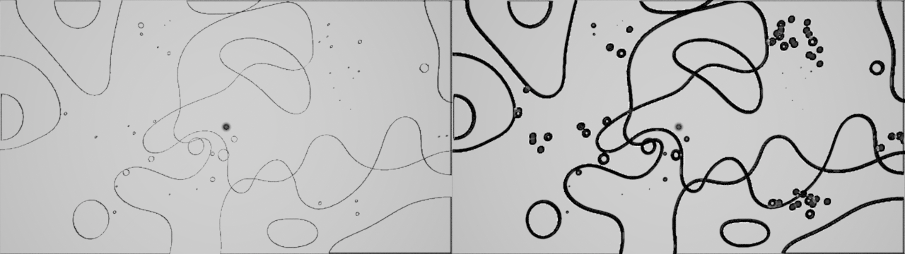

# State 048 · projected light through two slides

The curved case places two independently solved Basilisk slide footprints between a finite lamp and a matte receiver. The planar control has the same dye boundaries, depth order, triangle indices and volume per slide. Their signed difference measures redistribution of light when the menisci change shape. Their ratio can modulate a registered dye image in scene-linear RGB.

## Scene and registration

| Parameter | Both cases |
| --- | --- |
| Coordinates | Metres, +X right, +Y image up, +Z toward lamp |
| Source | Centred point lamp at +250 mm, emitting radius 0.7 mm, equivalent power 2 W |
| Receiver | Neutral white Lambertian plane at −35 mm |
| Camera | Orthographic at +150 mm looking straight at the receiver. Both slides are invisible to primary camera rays and visible to transmitted rays. |
| Field | 160 × 90 mm at the nominal z = 1.75 mm plane, mapped to 183.686 × 103.323 mm on the screen |
| Slide surfaces | Rear base at +2.5 mm, front base at 0 mm. Relief rises 0.35–1 mm on each slide. Both meshes remain separate. |
| Optical response | Stock white glass with relative IOR 1.403/1.333 and zero roughness |
| Integrator | Blender 4.5.16 LTS Cycles CPU, two render threads, fixed 96 samples per pixel, seed 48, 12 total bounces, 8 transmission bounces |
| Sampling and output | 640 × 360 scene-linear RGB float32 OpenEXR, zero exposure adjustment. Adaptive sampling and denoising disabled. |
| Unit calibration | 30,000 scene units/m. Coordinates and source radius scale linearly; numeric point-lamp power scales with the square to preserve irradiance. |
| Geometry | Rear 168,070 vertices and 336,120 triangles. Front 126,362 vertices and 252,696 triangles. Paired controls preserve the same XY coordinates and triangle indices. |

The screen camera images the computed illumination, so it does not see the front surface of the media. The projected field width follows the ratio of lamp–screen distance to lamp–reference-plane distance. The upper and lower surfaces use PLY vertex normals with Cycles' smooth-shading flag. The upper and lower faces of the planar control have constant parallel normals. Steep contour walls retain their geometric normals. Each PLY is watertight. Two independent 1024 × 576 float EXRs carry the signed distances in 720p design pixels.

Cycles traces the light transport. Its manifold next-event estimator connects diffuse receiver samples to the lamp through specular interfaces. The implementation requires smooth shading on every crossed caster face, caps the number of crossed interfaces at six and uses fixed geometric convergence thresholds in scene units. An ordinary path through both slabs crosses four interfaces. A ray hitting a sharp side face can lose the MNEE contribution. Bright curved/flat ratios close to a dark planar rim merit direct inspection in the individual EXRs. [Cycles object settings](https://docs.blender.org/manual/en/4.5/render/cycles/object_settings/object_data.html) · [Cycles MNEE implementation](https://github.com/blender/blender/blob/v4.5.16/intern/cycles/kernel/integrator/mnee.h)

The relative index represents an equivalent oil/water interface. The current scene measures neutral geometric refraction. Dye absorption, cover glass, objective aberrations and screen scatter beyond diffuse reflection are separate optical effects.

## Reproduce

Use Blender 4.5.16. From this directory, direct output into a new folder. Blender's bundled scene API imports geometry and assigns scene settings. Cycles runs in its native CPU backend.

```sh
mkdir -p renders
for shape in flat curved; do
  blender --background --factory-startup --disable-autoexec --threads 2 \
    --python-exit-code 1 --python cycles_scene.py -- geometry "renders/receiver-$shape.exr" \
    --shape "$shape" --save-scene "renders/state-048-$shape.blend"
done
blender --background --factory-startup --disable-autoexec --threads 2 \
  --python-exit-code 1 --python cycles_scene.py -- geometry renders/receiver-open.exr \
  --shape flat --empty-beam
blender --background --factory-startup --disable-autoexec --threads 2 \
  --python-exit-code 1 --python cycles_scene.py -- geometry renders/receiver-curved-no-mnee.exr \
  --shape curved --no-shadow-caustics
```

The saved scenes embed their meshes and materials. The open-beam control removes both casters. The fourth pass retains the curved geometry and disables Shadow Caustics only on the lamp. Every case uses the same camera, lamp, sampling seed and exposure.

## Measurements



The planar receiver shows fine dark boundaries. Curvature widens them considerably and produces smaller local bright excursions. Each preview tile uses the same sRGB transfer and exposure. The EXRs retain the original linear values. Hardware for the four sequential runs was a 2.60 GHz Intel Core i7-9750H with two render threads.

| Receiver pass | Mean linear radiance | Median | P99 | Peak | Time |
| --- | ---: | ---: | ---: | ---: | ---: |
| [Empty beam](receiver-open.exr) | 0.584413 | 0.589735 | 0.623008 | 0.623702 | 17.27 s |
| [Volume-matched planar controls](receiver-flat.exr) | 0.567025 | 0.586225 | 0.622916 | 0.638837 | 101.19 s |
| [Curved menisci](receiver-curved.exr) | 0.512093 | 0.580719 | 0.627914 | 0.991037 | 116.57 s |
| [Curved, lamp Shadow Caustics disabled](receiver-curved-no-mnee.exr) | 0.575323 | 0.138731 | 8.798403 | 29.942961 | 124.91 s |

All 230,400 planar receiver pixels are positive. Across the crop, planar/open integrated radiance is 0.97025, curved/open is 0.87625, and curved/planar is 0.90312. Curved/planar has a median of 1.000009, P99 of 1.13636 and maximum of 8.88016. The curved pass has 3,827 zero pixels (1.66%). All ratios use the raw float denominator.

For each receiver pixel, the ray from lamp centre crosses the estimated mid-height of each slide. At those two points, the smaller absolute signed distance gives distance to the nearest boundary. Within 8 design pixels, 41,556 pixels have a mean absolute departure of 0.47951 from unit gain. Beyond 24 design pixels, the mean departure falls to 0.00177 across 112,573 pixels. In clear regions beyond 24 design pixels on both slides, the median planar/open ratio is 1.0000.

Disabling the lamp's Shadow Caustics raises the mean to 98.44% of the empty-beam result through the curved geometry, while greatly increasing per-pixel variance. The MNEE estimates lose appreciable flux along the contours. The finite crop also allows energy to leave the frame. The study demonstrates geometrically registered redistribution and exposes an estimator limitation. Absolute rim brightness needs independent transport benchmarking before use as calibrated gain.

[Curved scene](state-048-curved.blend) · [Planar scene](state-048-flat.blend) · [Scene assembly](cycles_scene.py) · [Color comparison method](color-method.md)
