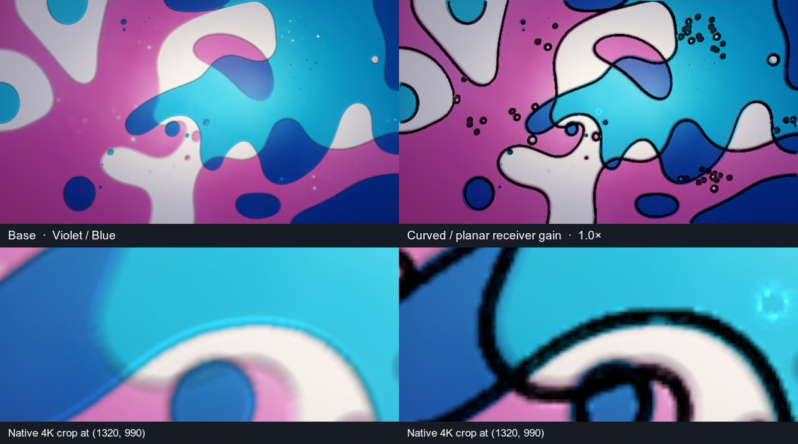

# Frame 048 receiver-light comparison



The measured receiver change produces dark, nearly continuous outlines on both slides. This is a geometric and sampling diagnostic. The comparison exposes an unresolved lighting error for the Mathmos look. [Full 16-bit sRGB base](../composite-srgb.png) · [Full 16-bit sRGB result](frame-048-relief-srgb.png)

The base is the full-resolution Violet / Blue wheel at frame 048. The lighting change comes from a pair of neutral Cycles exposures of the diffuse screen. The curved exposure uses the two independent slide meshes with relief. The planar exposure uses their matched flat controls. Both use the same lamp, camera and receiver. [Base exposure](../composite-srgb.png) · [Receiver scene and controls](README.md) · [Film geometry](../../lighting-geometry.md)

For each native receiver pixel, the compositor takes the ratio of curved to planar scene-linear luminance. Both exposures have full-rate 32-bit float RGB channels. A neutrality check limits channel divergence. The compositor bilinearly reconstructs this scalar ratio on the 3840 × 2160 grid with common normalized pixel centers and clamped edge sampling. It decodes the tagged 16-bit sRGB base with the piecewise sRGB inverse transfer function, multiplies each linear channel by the same ratio, clips to the displayable range, and re-encodes as tagged 16-bit sRGB. Gain is applied at unity strength with no averaging, exposure normalization, denominator offset, artistic multiplier or tone mapping. [Native compositor](receiver-color.cpp)

The camera looks down −Z with +Y at the top. The same midpoint of the 160 × 90 mm film crop registers to the center of the screen in both exposures. With the point source, areas on the individual slide planes have slightly different magnifications. The reference for the common screen framing is the 1.75 mm plane. The color result retains the base shader's rendered dye and meniscus response. It applies the simulated geometric illumination as a scalar multiplier and makes no spectral or physical projector calibration claim.

## Controls

The compositor rejects non-finite or negative irradiance, mismatched image windows and a zero denominator anywhere. It measures weak denominators below one quarter of planar p95. Shadowing at a flat solid's side wall or at the crop boundary can legitimately fall into that range. The gross failure check therefore tests the flat interiors at least 20 design pixels from both interfaces and at least 1% of each image dimension inside the crop. It rejects a pair if over 1% of those pixels are weak. All pixels, including side walls and borders, receive the raw ratio. The original 640 × 360 test had 173,399 zero planar pixels and a zero median, which prevented division there.

The final planar control has zero exact black pixels and 2,452 weak pixels overall. Only 59 of 122,096 tested interior pixels are weak. The relief control has 3,827 zero-radiance pixels overall, including 2,625 within 8 design pixels of an interface and zero in the tested far interior. The point source, receiver, geometrical field and integrator are the same for both exposures. Limited field of view, the steep mesh sides and loss of sampled light paths in Cycles can each affect the result. Their individual contributions remain unresolved.

With that final planar receiver supplied twice, the compositor reported a gain of exactly 1 everywhere. ImageMagick's absolute-error metric independently counted zero changed pixels between the input and re-encoded 4K PNG.

Registration is also checked against both source signed-distance images. The mean absolute gain change is evaluated near either interface (within 8 design pixels) and far from both (at least 20 design pixels). Horizontal and vertical mirror controls repeat the test. These checks retain every receiver pixel carried by each region.

Two independent sample points check the orientation of the dyed base. The front-only point at (768, 144) on the 1024 × 576 field maps to (2881, 541) on the 4K plate, where the 16-bit RGB codes are (7940, 44543, 52831), cyan. The rear-only point at (240, 344) maps to (901, 1291), where the codes are (44351, 18016, 37983), violet. Coordinates are zero-based from the top left. [Mesh occupancy verification](../../lighting-geometry.md)

| Gain statistic | Measured result |
| --- | ---: |
| Native receiver grid | 640 × 360 |
| Gain p05 / median / p95 | 0.010680 / 1.000009 / 1.008760 |
| Gain p99 / maximum | 1.13636 / 8.88016 |
| Mean absolute gain change near / far from boundaries | 0.47502 / 0.00169 |
| Same near / far test with horizontally mirrored geometry | 0.12547 / 0.10649 |
| Same near / far test with vertically mirrored geometry | 0.10999 / 0.10822 |
| Sum of curved exposure divided by sum of flat exposure over the receiver crop | 0.90312 |
| 4K pixels clipped in at least one output channel | 2,496 of 8,294,400 |

The difference is concentrated along the registered geometry. The 9.69% reduction in total receiver illumination and the deep bands are visible in the full-strength comparison. The 640 × 360 gain contains a lower spatial bandwidth than the dyed 4K base. [Numeric compositor output](color-measurements.txt)

Disabling manifold next-event estimation on the same curved scene gave 98.45% of the open-beam flux at 96 samples per pixel, with large isolated bright samples. The enabled path gave 87.63%. This estimator dependence limits how much of the darkening can be attributed to the physical interfaces. The color comparison uses the enabled exposure. [Raw receiver controls](README.md)

## Reproduce

Build from this directory with the native OpenEXR and libpng development packages. Pass a new output path. To repeat the identity control, supply the same positive planar EXR in both receiver positions and compare decoded pixels against the base.

```sh
c++ -std=c++17 -O2 -Wall receiver-color.cpp $(pkg-config --cflags --libs OpenEXR libpng) -o /tmp/tss-receiver-color
/tmp/tss-receiver-color ../composite-srgb.png receiver-curved.exr receiver-flat.exr /tmp/frame-048-relief.png geometry
```
