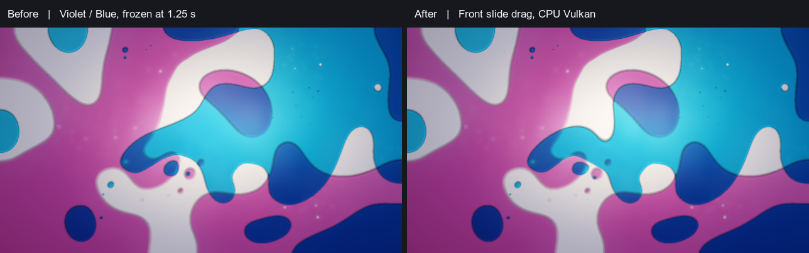

# Frozen front-slide drag on CPU Vulkan

Each panel is an unscaled 640 × 360 capture of the production live optical pass on SwiftShader. Both use the same pair of Basilisk distance fields at 1.25 s and the default Violet / Blue focus. The gesture moves from normalized screen position (0.40, 0.45) to (0.55, 0.52) on the front slide. The central cyan boundary bends down into the light passage. At least one RGB channel changed by three or more 8-bit codes in 13,149 of 230,400 pixels (5.71%). Switching to an untouched track reproduced every byte of the before capture.

To repeat, set `TSS_SOFTWARE_PROOF_DIR` to a fresh empty directory and run the software Vulkan test documented in the [live wheel guide](../../../../live-wheel/README.md). Its `before.ppm` and `after.ppm` files contain the two optical renders. This comparison places the labels above the captured pixels. Windows hardware FPS is measured separately in the running editor.
