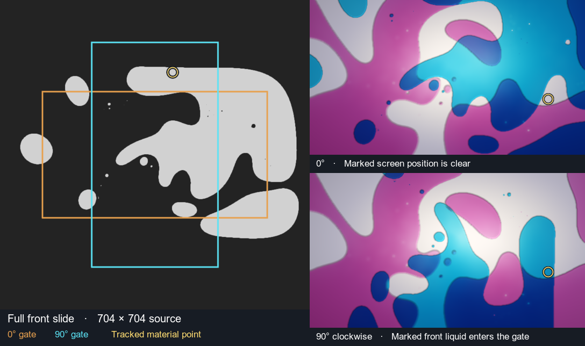

# In-plane pose and sealed-slide phase inventory

**Material tug** pulls the selected layer along the drag in its own material coordinates. **Rotate slide** rotates the complete selected cell about the optical center. Each track retains separate poses and material responses for its rear and front slides. The camera stays fixed. Neither operation changes the glass gap.

For a tug, the mouse-down point is the contact origin. The displacement vector from that origin saturates smoothly over 0.115 visible-film heights of hand travel. With response r between 0 and 1 the maximum twist amplitude is 0.13 + 0.29r radians. The pose follows the hand with a first-order spatial lag of 0.120 − 0.085r film heights. A pointer segment of length d applies a fraction 1 − exp(−d/lag) of the requested change. Heavy, Medium and Light use r = 0, 0.4 and 1 respectively. Release holds the pose and starts a new contact on the next drag. This kinematic response approximates handling during performance. The independent Basilisk geometry supplies the fluid state.

Each pull consists of two opposite radial twists, with centers offset by 0.050 film heights on either side of the contact and support radius 0.230. Within a twist the polar coordinate map is (r, φ) → (r, φ + α max(0, 1 − (r/0.230)²)³). It preserves the area element r dr dφ. Its inverse changes the sign of α. Their composition also preserves area, including when the direction, amplitude or contact changes. The renderer regenerates the displacement field from the current parameters. The 320 × 180 RGBA16F atlas stores both maps inside a compact square 0.64 film heights on each side, in each slide's own material frame. Displacements vanish before the atlas boundary. A rigid rotation has determinant one and uses square physical lengths in the film plane. The shader applies the inverse rotation analytically, then looks up the compact tug. These transforms preserve both phase volumes at fixed gap.

A finite film and a camera gate have different boundaries. Motion can carry a dyed region outside the gate and later bring it back. The source sampler uses the actual film extent. The remainder of the ray sees clear light. The sampler retains the complete unmodified source inventory.

## Measured controls

The old recursive drag accumulated folds after about one programmed revolution. At input 2,080 it had 2,055 folded cells in the 6,400-cell brush annulus and a minimum signed triangle area of −12.34. In the replacement, the same 2,082 input replay had zero folded cells at every checkpoint. The previously tugged front displacement stayed byte-identical throughout the rear drag. Signed triangle area, normalized to 1 for an undeformed cell, ranged from 0.9860 to 1.0129 across the sampled checkpoints. These are finite chord areas on a 320 × 180 grid reconstructed from half-float data. [Prior measurements](legacy-warp-folds.csv) · [Replacement measurements](bounded-tug-folds.csv) · [Native diagnostic](../../../../live-wheel/src/warp_diagnostic.rs)

The phase test holds source frame 30 fixed. It calls the production source-coordinate shader and classifies the subpixel bilinear signed-distance sample by its zero contour. For each slide inside its finite source, a subpixel is either dyed liquid or clear carrier. It integrates fractional occupancy at 4 × 4 subpixels per texel across a 768 × 768 square covering four visible film heights, totaling 9,437,184 subpixels. The full square includes the entire tested film through the quarter turn. A second count uses the camera gate. For constant gap the ratios of integrated areas are also ratios of phase volumes. The finite integration grid introduces boundary quadrature error.

On the original 512 × 288 cache, the largest fractional change among **all four full inventories** was 0.00520% after strong independent tugs and release. Adding a 90° rotation to the pulled front raised that maximum to 0.00709% relative to the initial pose. For the front dyed phase, the visible area fell from 0.40397 to 0.21293 in gate-area units, while the full area remained 0.40396. Both rear inventories stayed bit-identical between the front-rotation and preceding tugged states. The regression tolerance is 0.25% relative per phase. [Full phase measurements](phase-area-v1.txt)

## Complete slide behind the aperture

The bundled TSSDF002 cache stores a 704 × 704 world for each independently evolved slide. The fixed 512 × 288 optical gate begins at world texel (96, 208). The left panel displays front phase at state 30, with orange and cyan outlines showing the gate in front-slide material coordinates before and after rotation. The right panels are actual software-Vulkan renders of the shared live optics at 640 × 360, 1.25 seconds, reduced for display.

The tracked source texel is (392, 164), above the original aperture. Its stored front-distance code is 204, inside the dyed phase. A 90° clockwise front rotation carries it to screen pixel (554, 230). That pixel changes from RGB (202, 199, 205) to (13, 140, 187). Returning the front to 0° reproduced all 230,400 rendered pixels byte-for-byte. The rear pose and optical focus stayed fixed throughout. The measured result comes from the complete stored material extending above the original gate. [Full-slide asset](../../../../live-wheel/assets/slide-world.rg8.gz)

Repeating the two-phase area measurement on the expanded asset yielded a largest full-inventory change of 0.00120% after both tugs and release. With the front subsequently rotated by 90°, the largest change across all four inventories was 0.00098% relative to the initial state. Front dyed area inside the gate fell from 0.39760 to 0.28777 gate areas, while its full-slide area stayed 0.71699 to five decimal places. [Full world measurements](phase-area-v2.txt)
