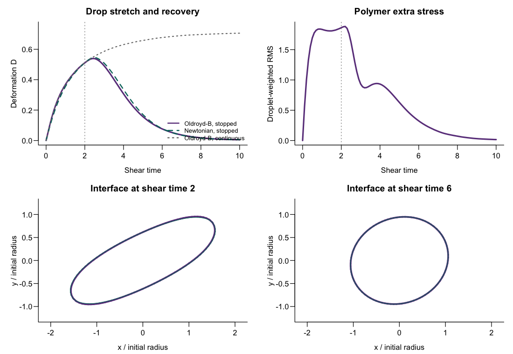

# Shear release of a viscoelastic drop

The 2D free-boundary test uses Basilisk geometric VOF, surface tension and its Oldroyd-B log-conformation solver. The reference drop continues in Couette shear. Two additional cases stop the walls at dimensionless shear time 2 and use identical initial velocity, drop geometry, density, interfacial tension and total zero-shear viscosity. One assigns half the droplet viscosity to a polymer with Deborah number 0.4. The Newtonian control assigns all droplet viscosity to the solvent. The velocity field decays after the walls stop. [Original benchmark](https://basilisk.fr/src/test/viscodrop.c) · [Exact source changes](stop-shear.patch)

At time 4, deformation was 0.3070 for the viscoelastic drop and 0.3351 for the Newtonian drop. At time 6 it was 0.0762 and 0.0781. Capillarity restores the shape in both cases. Only the Oldroyd-B case stored polymer stress, with droplet-weighted RMS 1.8625 at shutoff and 0.3238 at time 6. The largest relative phase-area drifts were 0.121% and 0.152%, respectively. These measurements characterize an isolated model drop. A sandwiched slide and a particular slime formulation require their own gap and rheology data. [All 101 measurements](deformation.csv)

The unmodified level-8 benchmark on the Windows workstation's WSL CPU matched all 101 reference deformation values at their recorded precision. RMSE against the 65 digitized Figueiredo points shipped with the upstream case was 0.00692. The stock case completed in 67.82 s. To reproduce on CPU, point `BASILISK` at the pinned Basilisk `src` directory and run `./run.sh new-directory` with R available for the plot. [Source identification and compiler setup](../basilisk-study/README.md)
